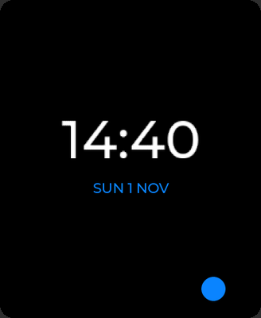

# Making a watchface

A handoff for writing a watchface of your own: from copying the template to
handing the `.so` to someone else. What a face is and where it lives on the
watch is in [FACES.md](FACES.md); this is how to make one, and the traps the
first five fell into.

You need the firmware's build working first ([BUILDING.md](BUILDING.md)): a
face is built against the firmware's symbol table, like an app. For an app
instead of a face, the template is `apps/hello_app` and the guide
[APP-GUIDE.md](APP-GUIDE.md); the README's *Starting points* puts the two
side by side.

## 1. Copy the template



`faces/face_hello/` is the smallest face that uses everything: the time and
the date as LVGL labels, a ball that rolls with gravity in `frame()`, a tap
that changes its colour, and a dimmed look.

```bash
cp -r faces/face_hello faces/face_mine
cd faces/face_mine
mv main/face_hello.c main/face_mine.c
sed -i '' 's/face_hello/face_mine/g' CMakeLists.txt main/CMakeLists.txt
rm -rf build sdkconfig dependencies.lock managed_components
```

Then in `main/face_mine.c`:

- `face->id = "face.mine";` with a dot: it names the face's catalogue
  (`face.mine.lang`) and is what the preference stores. The firmware's own
  faces have dotless ids; yours must not.
- `face->name = N_("Mía");` the name in the picker. Spanish is the source
  language of the UI (docs/I18N.md); it is translated like any other string.
- The **file name** is `face_<something>.so`, under 24 characters: the
  folder name decides it, and SPIFFS names are 32 bytes with `/faces/` in
  front. Anything not called `face_*` is ignored by the watch.

## 2. Try it on the Mac

The simulator compiles every face of `faces/` in, after the firmware's seven:

```bash
cd sim && cmake -B build && cmake --build build -j8
AOS_SIM_FACE=face.mine ./build/amoledos_sim
```

| To try | How |
| --- | --- |
| tilting | `i` three times for the posture "in the hand", then the mouse is the wrist |
| dimmed | `a` |
| the picker | `w`, a long press, or a double tap |
| a language | `t` (es, de, en, the pseudo-language `xx` that shows overflows) |
| a screenshot | `AOS_SIM_SHOT=/path/x.ppm AOS_SIM_SHOT_MS=2000`, then `tools/ppm2png.py` |
| a script of taps and tilts | `AOS_SIM_KEYS="ms:500,tap:184x200,tilt:0.2,0"` (BUILDING.md) |

The simulator draws everything through LVGL and has no panel to blit to, so
it is faster than the board: frame rates are measured on the watch, never
here.

## 3. The contract, callback by callback

`components/aos_ui/include/aos_watchface.h` is the whole of it.

| | When | What it must do |
| --- | --- | --- |
| `create(root)` | the face is mounted: chosen, previewed in the picker, back from an app | Build under `root` (368x448, black) and return its context. Mounting happens often (every app that closes mounts the face again): keep it under ~100 ms. |
| `refresh(ctx, now)` | 5 times a second lit, once a minute dimmed | Change what changed. Compare with what is drawn and return at once otherwise: setting a label's text to the same text still redraws it. |
| `set_aod(ctx, aod)` | the screen dims or lights | Dimmed: mostly black, grey text, nothing moving. On AMOLED a pixel that is off costs nothing, and the panel holds the image with the chip asleep. |
| `frame(ctx, dt_ms)` | every `frame_ms` (0 = 33), only while lit and on the screen | Move things. The host owns the timer: dimmed or under an app there is none. If nothing moved, draw nothing. |
| `touch(ctx, what, x, y)` | with `AOS_FACE_FLAG_TOUCH` | `TAP` arrives ~300 ms after the finger lifts (a second tap would be the double tap that opens the picker). Return `true` only for what you used. **Leave `LONG` alone**: it opens the picker, and a face that took it was hard to leave. |
| `destroy(ctx)` | another face takes its place | Free everything that is not under `root`: buffers, `lv_timer`s, animations, HTTP requests. **The module is unloaded right after**, and anything left running calls into code that is gone. |

What the host lends besides:

- `aos_watchface_gravity(&x, &y, &z)`: gravity in g in the screen's axes, x to
  the right edge, y to the bottom edge, z into the glass. Standing in front of
  you it reads (0, 1, 0).
- `aos_watchface_live()`: whether the face is lit on the screen, for one that
  animates from `refresh()`.
- `aos_watchface_can_blit()`: whether nothing is drawn over it, so it may
  push pixels straight to the panel.
- `aos_watchface_path(i)`: where a module face's `.so` is, to find files of
  its own beside it.
- The rest of the HAL, as an app has it: the battery, the steps, preferences,
  HTTP (`aos_hal_http_request`, asynchronous, three slots for the whole
  system), the time.

## 4. Drawing: pick the cheapest way that does the job

| The face | The way | Examples |
| --- | --- | --- |
| changes once a minute | LVGL labels, arcs and images | the firmware's seven, Home, `face_hello` |
| a few small things move | LVGL objects moved in `frame()` | `face_hello`'s ball |
| much of it moves | a half-resolution scene through `faces/common/face_common.h` | Water, Sand, Orbits, Kaleidoscope |

What it costs on the board, measured:

- A full-screen canvas through LVGL is ~95 ms a frame: 10 fps at best. The
  blit to the panel is ~16 ms. `face_common.h` blits when it can and keeps the
  canvas right for when LVGL has to draw (an overlay leaving).
- A label scaled with `aos_label_scaled()` is a transformed layer: cheap
  once a minute, expensive if something moves behind it every frame. With
  `face_common.h` the text is a mask drawn once (`fc_mask_text`).
- Reading the IMU is an I2C transfer: ~1 ms. Every frame is fine.
- Water and Sand get 29 fps, Orbits 24, the Kaleidoscope (every pixel, every
  frame) 15-16: its own drawing is 14 ms, presenting 45.

With `face_common.h`: draw the scene into `fc.small` (184x224 RGB565,
`fc_rgb()` / `fc_mix()`), call `fc_present()` with the rectangle that changed
(in half-resolution units), and keep text in `fc.mask[]`. Water and Orbits
render the whole scene and compare it row by row with what is on the screen;
Sand marks the cells it changes. Either way, a frame where nothing changed
presents nothing.

**What the compiler does behind your back.** A module can only call what the
firmware lends it (`tools/gen_symbols.py`). `build_apps.sh` lists anything
else and refuses: do not install a `.so` it refused, the watch cannot load
it. It has happened with `strcspn` (write the loop) and with a byte swap
(gcc turns one into `__bswapsi2`, which the firmware lends since v0.15.0).

## 5. Text and languages

Mark strings as an app does: `_("...")` where they are drawn, `N_("...")`
in a static table. Then:

```bash
python3 tools/gen_lang.py template en      # and de
```

writes `sim/sim_fs/lang/<code>/face.mine.lang` (your strings) and adds your
face's name to `_sistema.lang` (the picker and Settings draw it with the face
not loaded). Translate them there: one line per string, the Spanish, a TAB,
the translation. `gen_lang.py check en` says what is missing. On the watch the
packs go in the card's `/lang/<code>/`.

Only Latin-1 is in the fonts (accents yes, emoji no): text from the internet
needs cleaning (Home's `clean_copy()`).

## 6. Settings and a page in the portal

A face with settings keeps them in a file beside itself in the flash, written
by a page of its own in the portal; Home does it this way:

- `web/face_mine.html` next to `main/`: a whole HTML page that loads `/aos.css`
  and `/aos.js` (template: `faces/face_casa/web/face_casa.html` or
  `apps/hello_app/web/hello_app.html`). It is served at `/face_mine` and
  listed in the portal's ribbon.
- The page writes `face_mine.cfg` with `POST /api/upload?dir=faces&name=face_mine.cfg`;
  the face finds it with `aos_watchface_path()` (in the simulator, in
  `sim/sim_fs/data/`, which is what `tools/portal_dev_server.py` maps
  `dir=faces` to). Read it again now and then: a save from the page should
  show without touching the watch.
- Settings files are kept when the face is removed.

## 7. Build it, put it on the watch

```bash
./tools/build_apps.sh face_mine                 # face_mine.so, ABI and symbols checked
./tools/install_apps.sh <watch>.local face_mine # into the flash, then a restart
```

`install_apps.sh` uploads the `.so` (and the page) straight into the flash
and restarts the watch: through the cable if there is one, over wifi
otherwise. A face is registered at boot, so nothing shows before the
restart. The log (`/registro`) says `faces: N registered` and, for yours,
`face face.mine opened from /spiffs/faces/face_mine.so in N ms`; a refusal
says why (ABI, a symbol, no room).

## 8. Giving it to someone

The `.so` is all it takes (and the page, and the `.lang` files if you
translated it). They copy it into their card's `/faces` and restart: the
watch installs it into the flash by itself and it appears in the picker.
They remove it from the portal's `/ajustes`, *Watchfaces from the card*.

A face built against one firmware loads on another only with the same face
ABI (`AOS_FACE_ABI_VERSION`, in the header) and the symbols it uses still lent:
say which firmware it was built for.

## 9. Before sharing it

- [ ] It builds with `build_apps.sh` with no FAIL.
- [ ] Dimmed it is mostly black and nothing moves.
- [ ] A frame where nothing moves draws nothing (on the board: the log is
      quiet and the battery too).
- [ ] `destroy()` leaves nothing: go in and out of an app ten times, change
      faces in the picker back and forth.
- [ ] The long press opens the picker on it.
- [ ] Anything touchable is above y = 395: the touch reports nothing lower.
- [ ] The texts fit in English and German (and `xx`).
- [ ] No local paths in the `.so` (`build_apps.sh` checks), no tokens or
      addresses of your house in the code: those go in a settings file.
