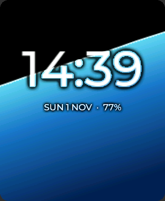
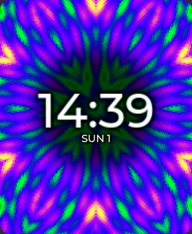
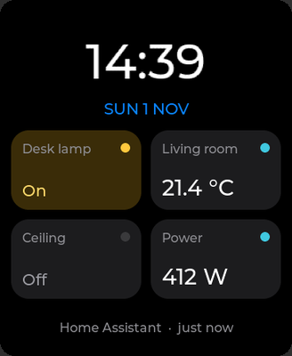
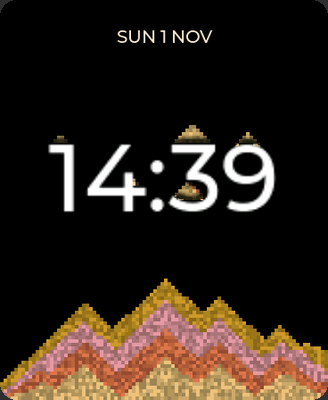
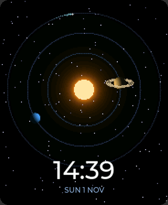
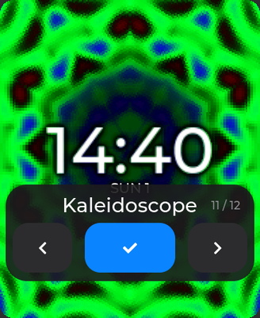

# Watchfaces from the card

Since v0.15.0 a watchface can come as a module of its own, a `.so` like the
apps, instead of being compiled into the firmware. The firmware's seven are
still there; the release brings five more on the card, and anyone can add
one without building the firmware: [FACE-GUIDE.md](FACE-GUIDE.md) is how,
starting from the template in `faces/face_hello`.

| | | | | | |
|---|---|---|---|---|---|
|  |  |  |  |  |  |
| Water | Kaleidoscope | Home | Sand | Orbits | the picker |

## The five

| Face | What it shows | What it does |
| --- | --- | --- |
| **Water** (`face.agua`) | the battery, as the level of water in a glass | The surface stays level with the ground wherever the watch points, and lags behind on a spring, so a flick of the wrist makes it slosh. A shake raises bubbles, the charger a stream of them; a tap drops a ripple where the finger was. |
| **Kaleidoscope** (`face.kaleido`) | the time, at the centre of twelve mirrors | Tilting turns the tile of colour behind the mirrors; **a tap** makes the colours flow into a new palette; **a shake** of the wrist drops a new tile into the chamber. Dimmed, only a dark ring of glass is left. |
| **Home** (`face.casa`) | the time and four things from Home Assistant | A sensor shows its value and unit, a light or a switch whether it is on, and **a tap on it toggles it**. Asked every 30 s while the screen is lit, never while it is dimmed. Its page is `/face_casa`. |
| **Sand** (`face.arena`) | an hourglass with no glass | Every minute a handful of sand falls in from wherever "up" is; every ten minutes the colour changes, so the bands of the heap read the minutes. The sand piles on the digits and pours around them, and slides when you tilt the watch. On the hour it drains away. |
| **Orbits** (`face.orbitas`) | the time as a small solar system | The hour is a ringed planet, the minute a blue one, the second a comet with its tail. The stars behind are three layers at different depths: tilting the watch slides them against each other. |

### Home's list

What Home shows is its own list, written by its page in the portal
(`<watch>.local/face_casa`): up to four entities, each with an optional name.
With no list it shows the four sensors chosen for the Sensores app. The
address and the token are Remoto's, the same connection every Home Assistant
thing on the watch uses; the page can set them too. The lights, switches,
`input_boolean`, fans and automations toggle with a tap
(`homeassistant.toggle`); anything else is read only, and a tap asks for
fresh values.

The list is `face_casa.cfg` beside the face in the flash, in the Sensores
format (`light.lamp|Lamp;sensor.temp`), and the face reads it again every
30 s: a change from the page shows without touching the watch.

## Choosing one

As always: a long press on the clock opens the picker, and so does Settings >
Display > Watchface and the portal's `/ajustes`; new in v0.15.0, **a double
tap on the clock opens it too**. The picker itself is bigger: the arrows and
the confirm are 70 px tall, the name is large, "3 / 12" says where you are
instead of a dot per face, and **a swipe sideways** anywhere goes to the next
or the previous face (left and right, as pages go).

The Kaleidoscope first kept the long press for itself (hold for the colours),
and on the wrist getting out of it was a fight over the same gesture: no face
here takes the long press any more.

## Where they live: the card delivers, the flash keeps

```
card    /faces/face_agua.so       delivered here (the release's apps.zip, faces/)
        /faces/face_casa.html     a face's portal page, if it has one
flash   /spiffs/faces/face_agua.so    installed here, and run from here
        /spiffs/faces/faces.idx       what is installed: sizes, dates, ids, names
        /spiffs/faces/face_casa.cfg   a face's own settings
```

At every boot, **before the UI exists**, `aos_dynapp_faces_init()`
(`components/aos_dynapp/aos_dynapp.c`):

1. reads `faces.idx`, the one file that says what the flash has installed;
2. copies into the flash every `face_*.so` and `face_*.html` of the card's
   `/faces` that the index does not have, or has older (the card's date is
   kept on the copy, so the next boot sees them equal and copies nothing),
   and opens a copied face once to learn its id and name;
3. registers every installed face with the watchface host, by its id and its
   name, from the index.

The index is there because SPIFFS answers every `stat()` and every open by
walking its pages: asking the flash about each face cost the boot 0.6 s with
nothing to do; with the index it is 34 ms. Whatever changes the folder behind
its back deletes it (an upload or a delete through the portal of a face or a
page, a face removed; a face's settings file does not count), and the next
boot walks the flash once, ~0.5 s, and writes it again.

So the face chosen is in the registry when the clock is mounted, and it is
mounted **from the flash**: with the card out, unreadable or half-mounted,
the watch still comes up on it. A face whose file has gone falls back to the
first one that loads, without forgetting the preference: it comes back on
the boot that finds it again.

Only the face on the screen takes memory: its module is opened when it is
mounted and closed when another face takes its place.

- **Updating** a face: a newer `.so` on the card, and a restart. Or
  straight into the flash through the portal (`dir=faces`), which is what
  `tools/install_apps.sh` does; a copy uploaded that way is newer than the
  card's and is not undone at boot.
- **Removing** one: the portal's `/ajustes`, *Watchfaces from the card*,
  *Remove* (`POST /api/esferas/quitar id=face.x`). It goes out of the
  registry and its files out of the flash **and** the card's `/faces`, or the
  next boot would install it again; its settings file stays, so putting it
  back finds them. If it was the face on the wrist, the first face takes its
  place. The firmware's seven cannot be removed.
- The flash keeps 512 KB free whatever faces come: a face that would go
  under that is not installed, and the log says so. A face is 10 to 12 KB.
- The file name is `face_<something>.so`, under 24 characters: SPIFFS names
  are 32 bytes with the `/faces/` in front.

## Writing one

The step by step, with the traps, is [FACE-GUIDE.md](FACE-GUIDE.md); this is
the shape of it. A face is a folder in `faces/`, laid out like an app
(`faces/face_hello` is the template, and is not among the release's faces):

```
faces/face_x/
  CMakeLists.txt         project(face_x), the apps' common.cmake, project_so
  sdkconfig.defaults
  main/face_x.c          the face
  web/face_x.html        its portal page, optional
```

```bash
./tools/build_apps.sh face_x            # builds face_x.so, checks ABI and symbols
./tools/install_apps.sh <watch> face_x  # into the flash; restart the watch
cd sim && AOS_SIM_FACE=face.x ./build/amoledos_sim   # on the Mac, compiled in
```

The contract is `components/aos_ui/include/aos_watchface.h`. A face fills an
`aos_watchface_t` and exports it with `AOS_FACE_ENTRY(get_fn)`:

```c
static bool x_get(aos_watchface_t *face)
{
    face->id       = "face.x";       /* with a dot: it names its catalogue */
    face->name     = N_("Equis");
    face->create   = create;         /* build inside the 368x448 root */
    face->refresh  = refresh;        /* 5 times a second lit, once a minute dimmed */
    face->set_aod  = set_aod;
    face->destroy  = destroy;
    face->frame    = frame;          /* optional: an animated face */
    face->frame_ms = 33;
    face->flags    = AOS_FACE_FLAG_TOUCH;   /* optional: it takes the finger */
    face->touch    = touch;
    return true;
}
AOS_FACE_ENTRY(x_get);
```

What the host gives a face, new in v0.15.0:

- **`frame(ctx, dt_ms)`**, every `frame_ms`, only while the face is what the
  screen shows, lit: not dimmed, not under an app, the launcher or the
  control centre. The host owns the timer and it does not exist while the
  screen is dimmed, so an animated face costs nothing with the screen off and
  does not wake light sleep. A frame with nothing to move should draw
  nothing.
- **`touch(ctx, what, x, y)`**: press, move, release, tap and long press. A tap
  arrives ~300 ms after the finger goes up, because a second tap there is the
  double tap that opens the picker. A face that returns `true` for the long
  press keeps it; `false` and the picker opens.
- **`aos_watchface_gravity(&x, &y, &z)`**: gravity in the screen's axes, in g
  (x to the right edge, y to the bottom edge, z into the glass). The board's
  own axes (measured on 2026-08-28: +ax is down, the right is -ay, face up is
  -az) are known in that one place.
- **`aos_watchface_live()`**: what `frame()` already knows, for a face that
  animates from its `refresh()`.
- **`aos_watchface_path()`**: where a module face's file is, so a face finds
  its own settings beside it (Home does).
- **`aos_watchface_can_blit()`**: whether nothing is drawn over the face, so
  it may push its pixels straight to the panel (`face_common.h` does).

A face's texts are marked like an app's (`_()` and `N_()`); `tools/gen_lang.py`
files its name in `_sistema.lang` (the picker and Settings draw it without
the face loaded) and the rest in `face.x.lang`, which the host loads while
the face is mounted.

**`destroy()` must leave nothing of the face behind**: timers, animations,
HTTP requests. The module is unloaded right after it, and a timer of the face
left running would call into code that is no longer there.

### Drawing fast: `faces/common/face_common.h`

The animated faces share one way of drawing, the one 2043 and Arkanos
measured on the board: the scene at half resolution (184x224), doubled by
hand into the canvas' 368x448 RGB565 buffer with 32-bit writes (letting LVGL
stretch it cost 129 ms a frame), and only the rectangle that changed
presented and invalidated. The time and the date are masks at full
resolution, rendered once when they change and blended over the scene in the
same pass, so the digits stay sharp while the water moves behind them; a soft
dark halo makes them readable over a bright scene.

When nothing is drawn over the face, the frames go straight to the panel
(`aos_hal_display_blit`) instead of through LVGL, and the canvas is brought
up to date just before LVGL next draws it. Water and Orbits render the whole
scene and compare it row by row with what is on the screen; Sand redraws only
the cells that changed; the Kaleidoscope changes every pixel every frame, so
it asks for 20 fps instead of 30. The first three stop drawing when nothing
moves.

## What is verified, and what is not yet

On the board (a v2, the home watch, 2026-11-01):

- **The picker**, by hand: the long press and the double tap, the arrows and
  the swipe sideways, on every face and the Kaleidoscope's too.

- **Installing from the card**: the five faces and Home's page copied into
  the flash at the first boot (~0.45 s a file: SPIFFS writes slowly), and
  registered. A newer `.so` on the card replaced the flash's at the next
  boot; one uploaded to the flash through the portal (`install_apps.sh`) was
  newer than the card's and was left alone, as it should.
- **What it costs a boot**: 34 ms with nothing to copy (from the index);
  ~0.5 s the one boot after the folder changed through the portal (the flash
  walked and indexed again); ~0.45 s per file copied from the card. Before
  the index it was 0.6 s every boot: a `.desc` and a `stat()` per face, and
  SPIFFS answers each slowly.
- **Frame rates**, watch on the table, screen lit:

  | Face | asks for | gets | the face's own time a frame |
  | --- | --- | --- | --- |
  | Water (still) | 30 | 29 | ~1 ms (reading the IMU) |
  | Sand | 30 | 29 | <1 ms |
  | Orbits | 25 | 24 | ~10 ms |
  | Kaleidoscope | 20 | 15-16 | ~60 ms: 14 drawing, 45 presenting |

  The Kaleidoscope changes every pixel every frame. Through LVGL it got 9-10
  fps (a full-screen canvas costs ~95 ms there); pushing the frames straight
  to the panel (`aos_hal_display_blit`, when nothing is over the face) took
  it to 14, and writing only the panel's copy while blitting to 15-16. The
  rest is the blit itself, which waits for each 20-row strip (~16 ms), and the
  doubling with the time's mask; past that it would take drawing on the
  other core, the way Turbo does.
- **Removing** from the portal: a face out of the registry, the flash and
  the card, the firmware's refused, and the face on the wrist replaced by
  Digital at once, with no restart.
- In the simulator as well: the dimmed modes, tilting with the mouse,
  English and German (a language change now rebuilds the face), and Home
  against `fake_ha.py`: values, a light toggled by a tap and asked again,
  its page saving the list.

Not tried yet: a boot with the card out (the face comes from the flash, so it
should not notice), and Home against the real Home Assistant.
